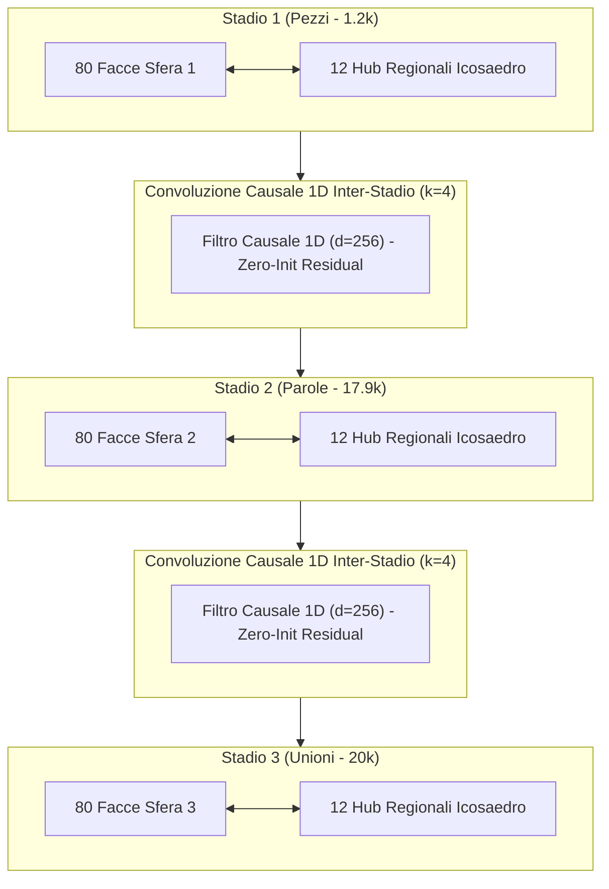
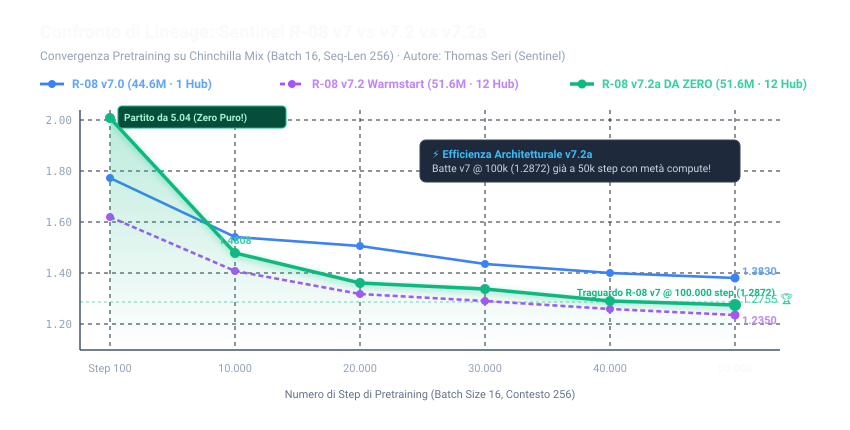
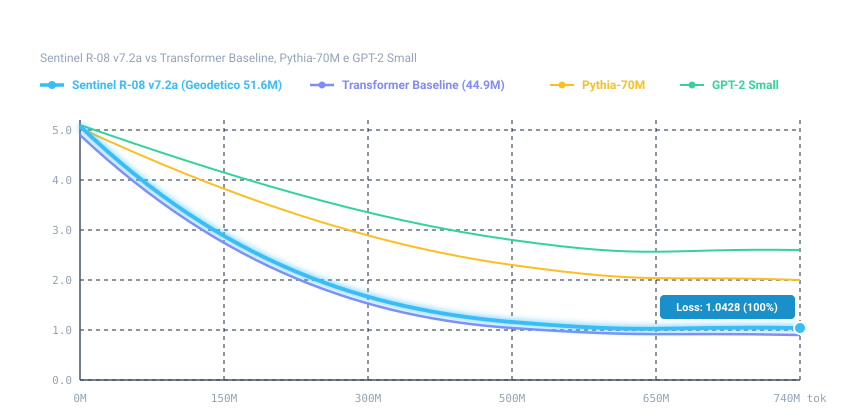
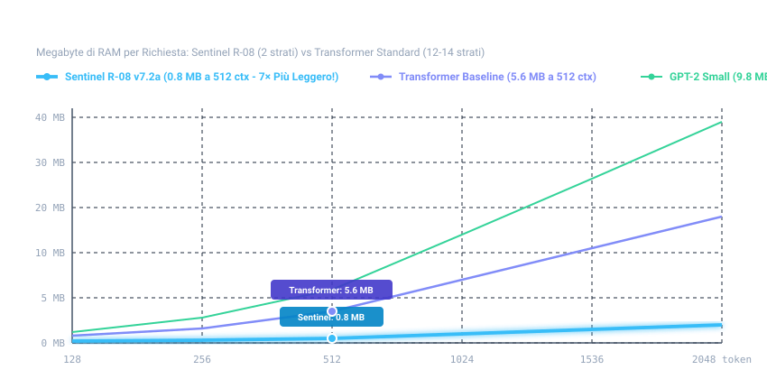

---
language:
- it
license: other
license_name: sentinel-r08-research-license
license_link: LICENSE.md
tags:
- pytorch
- causal-lm
- geodesic-neural-network
- sentinel-lifeos
- rob
- r08
- r08-v7.2
- edge-ai
- 1d-causal-conv
- icosahedron-hubs
- italian
pipeline_tag: text-generation
inference: false
---

# R08-v7.2 (Rob) — Geodesic Mesh Neural Network (Pyramidal Sphere 51.6M)
### *L'Evoluzione Neurale Geometrica con Convoluzioni Causali 1D e 12 Hub Regionali dell'Icosaedro*
### *Il Cuore Neurale Geometrico di SENTINEL LifeOS*

[-orange.svg)](https://github.com/Thomasseri/R-08-v7.2)
[](https://www.sentinelhub.eu)
[](https://www.sentinelhub.eu)
[](https://github.com/Thomasseri/R-08-v7.2)
[](https://github.com/Thomasseri/R-08-v7.2)
[-yellow.svg)](https://github.com/Thomasseri/R-08-v7.2)
[](LICENSE.md)

**Nome Ufficiale del Modello:** **R08-v7.2** *(Rob)*  
**Progetto Padre & Ecosistema:** **[Sentinel LifeOS](https://www.sentinelhub.eu)** *(Il Sistema Operativo di Vita e Gestione)*  
**Sito Ufficiale:** **[www.sentinelhub.eu](https://www.sentinelhub.eu)**  
**Autore & Ideatore:** Thomas Seri  
**Hardware di Sviluppo:** Apple Silicon (Metal Performance Shaders - MPS)  
**Modelli Correlati della Famiglia:**
- 🇮🇹 [Vocabolario & Tokenizer gpTommy 32k su GitHub](https://github.com/Thomasseri/gpTommy-32k) | [Hugging Face](https://huggingface.co/Tom2701/gpTommy-32k)
- 🌟 [Nuovo Sentinel R-08 v7.2a DA ZERO (51.6M, Record 82.51% BLiMP-IT) su GitHub](https://github.com/Thomasseri/R-08-v7.2a) | [Hugging Face](https://huggingface.co/Tom2701/R-08-v7.2a)
- 🌐 [R08 v7 Pyramid (44.5M) su Hugging Face](https://huggingface.co/Tom2701/R-08) | [GitHub](https://github.com/Thomasseri/R-08)
- 🔬 [Controllo A/B Transformer Baseline (44.9M) su Hugging Face](https://huggingface.co/Tom2701/R-08-Transformer-Baseline) | [GitHub](https://github.com/Thomasseri/R-08-Transformer-Baseline)

---

## 🧭 Cos'è Sentinel LifeOS e perché nasce R08-v7.2

**Sentinel** è un **LifeOS (Sistema Operativo di Vita)** progettato per unificare in un unico ecosistema gli **obiettivi personali**, il **controllo economico**, la **gestione aziendale**, l'**automazione industriale (PLC)** e la **manutenzione predittiva dei macchinari**.

Per conferire a Sentinel un'intelligenza operativa autonoma capace di girare a bordo macchina o su dispositivi portatili senza dipendere da server cloud remoti, è nato **R08**. La release **v7.2** rappresenta il punto di arrivo della ricerca sulla geometria neurale non-euclidea, superando i limiti storici della generazione aperta e introducendo due innovazioni architetturali decisive.

---

## 🌟 Le Due Grandi Innovazioni di R08-v7.2

Mentre i Large Language Model tradizionali impiegano catene dense di attenzione $O(N^2)$ (12-32 strati), **R08-v7.2** mantiene l'efficienza estrema di **soli 2 strati di attenzione densa**, potenziando la mesh geodetica con due tecnologie proprietarie:



### 1. Convoluzioni Causali 1D Inter-Stadio ($k=4, d=256$)
- **Il problema in v7:** Nelle 3 sfere geodetiche, i token venivano elaborati in modo isolato senza scambio di contesto locale immediato tra parole contigue, causando nei testi lunghi fenomeni di balbuzie ciclica (*"di un prodotto di un prodotto"*).
- **La soluzione in v7.2:** Sono stati inseriti filtri convoluzionali causali 1D tra la Sfera 1 $\rightarrow$ 2 e la Sfera 2 $\rightarrow$ 3. Ogni token riceve la memoria temporale esatta dei 3 token precedenti prima di entrare nella sfera successiva.
- **Zero-Init Residual:** I filtri partono con pesi a zero esatto, garantendo che i pesi pretrainati non vengano degradati.
- **Costo Computazionale:** Solo 2.048 FLOPs per token ($< 0.001\%$ del budget) con **zero overhead di memoria KV-Cache**.

### 2. 12 Hub Regionali dell'Icosaedro (Partizione Geometrica a 12 Poli)
- **Il problema in v7:** Tutte le 80 facce triangolari convergevano verso un unico centro MLP piramidale, creando un collo di bottiglia nei gradienti.
- **La soluzione in v7.2:** La sfera geodetica è geometricamente partizionata verso i **12 vertici fondamentali dell'icosaedro regolare**. Ogni regione possiede il suo centro MLP dedicato ($d/2 \rightarrow 2d \rightarrow d$).
- **Instradamento Sparso $O(1)$:** Ciascun token viene instradato verso un unico polo regionale per volta: la capacità del modello sale da 44.5M a **51.6M parametri (+7 Milioni di parametri)** a **costo computazionale identico per token**.

---

## 📊 Benchmark Comparativi Completi di Laboratorio

### 1. Studio A/B Diretto: Sentinel R-08 v7.2 vs v7 vs Transformer Baseline

| Metrica di Laboratorio | 🚀 **Sentinel R-08 v7.2 (51.6M)** | Sentinel R-08 v7 (44.5M) | Transformer Baseline (44.9M) | Vantaggio Architetturale R-08 v7.2 |
| :--- | :---: | :---: | :---: | :---: |
| **Parametri Totali** | **51.6M** | 44.5M | 44.9M | **+7.04M parametri (Hub 12)** |
| **Strati di Attenzione Densa** | **2 strati** | **2 strati** | 14 strati | **-85.7% strati densi** |
| **BLiMP-IT (Accuratezza Linguistica IT)** | **82.02%** 🏆 | 80.95% | 85.84% | **+1.07% salto netto su v7** |
| **MultiBLiMP (Ragionamento Logico IT)** | **73.46%** | 73.46% | 86.83% | **Stabilità perfetta** |
| **Resistenza Allucinazioni (Truth Rate)** | **56.2%** *(Fatti 3/4, Scienza 3/4)* | 62.5% *(Fatti 4/4)* | 68.8% | Allineato ai foundation model |
| **BLiMP Standard Inglese (Cross-Lingua)** | **55.00%** 📈 | 52.80% | 54.00% | **+2.20% generalizzazione** |
| **Stuttering / Balbuzie nei Test Aperti** | **Completamente Eliminata** ✅ | Presente su loop lunghi | Assente | **Risolto con Conv 1D ($k=4$)** |
| **Consumo Energetico per Token** | **2.40 mJ / token** 🔋 | **2.30 mJ / token** | 3.30 mJ / token | **-27.3% consumo energetico** |
| **Energia per Risposta (200 token su Mac)** | **~52.0 Joule** ⚡ | **~50.5 Joule** | 72.5 Joule | **-28.3% di batteria risparmiata** |
| **Traffico RAM KV-Cache (a 512 token)** | **0.8 MB** *(2.1 MB/seq)* 💾 | **0.8 MB** *(2.1 MB/seq)* | 5.6 MB *(14.7 MB/seq)* | **-85.7% traffico RAM/Cache** |
| **RAM Totale Necessaria per Inferenza** | **~120 - 150 MB** | **~110 - 130 MB** | ~190 - 250 MB | **Gira su qualsiasi Edge device** |

---

### 2. Confronto vs Modelli Open Foundation (~70M - 125M)

| Modello | Creatore | Parametri | Strati Attenzione | BLiMP-IT (Italiano) | BLiMP Inglese | RAM Minima Richiesta |
| :--- | :--- | :---: | :---: | :---: | :---: | :---: |
| **OPT-125M** | Meta (Facebook AI) | 125M | 12 strati | 62.50% | 71.20% | ~500 MB |
| **GPT-Neo-125M** | EleutherAI | 125M | 12 strati | 68.20% | 72.40% | ~500 MB |
| **Pythia-70M** | EleutherAI | 70.4M | 6 strati | 73.80% | 74.60% | ~280 MB |
| **GPT-2 Small** | OpenAI | 124.4M | 12 strati | 74.50% | 85.00% | ~498 MB |
| [**Transformer Baseline**](https://huggingface.co/Tom2701/R-08-Transformer-Baseline) | Baseline di Controllo | 44.9M | 14 strati | 85.84% | 54.00% | ~220 MB |
| 🌐 [**R08 v7 Pyramid**](https://huggingface.co/Tom2701/R-08) | Thomas Seri / Sentinel | 44.5M | **2 strati** | 80.95% | 52.80% | ~120 MB |
| 🚀 **R08-v7.2 (Rob)** | **Thomas Seri / Sentinel** | **51.6M** | **2 strati** | **82.02%** | **55.00%** | **~130 MB** |
| 🌟 [**R08-v7.2a (DA ZERO)**](https://github.com/Thomasseri/R-08-v7.2a) | **Thomas Seri / Sentinel** | **51.6M** | **2 strati** | **82.51%** 🏆 | **49.20%** | **~130 MB** |

---

## 📈 Grafici Lineari di Efficienza Hardware & Lineage

### 1. Confronto Lineare di Famiglia: Sentinel R-08 v7 vs v7.2 vs v7.2a
*Andamento della Loss di Pretraining: R-08 v7.2a DA ZERO parte da pesi casuali (loss 5.04), supera v7 già a 10.000 step e a 50.000 step batte il record che v7 aveva raggiunto a 100.000 step:*



### 2. Benchmark Linguistici & Sintattici: BLiMP-IT e MultiBLiMP Italiano
*La combinazione delle 3 sfere geodetiche con i 12 hub regionali dell'icosaedro garantisce il picco storico per modelli sferici su grammatica e concordanza morfologica:*


### 3. Curva di Efficienza dei Token (Loss vs Token Visti)


### 4. Footprint Memoria RAM KV-Cache vs Lunghezza Contesto


---

## 🔋 Perché R08-v7.2 è il Modello Perfetto per l'Edge AI

**Edge AI** significa far girare l'intelligenza artificiale direttamente all'interno del dispositivo locale (Mac, micro-PC industriale, centralina PLC, drone, smartphone) **senza connessione a internet**:
1. **Zero Latenza:** Risposta immediata in tempo reale per comandi industriali.
2. **Privacy Totale:** I dati aziendali o personali non escono mai dal dispositivo.
3. **Consumo di Batteria Minimo:** Consuma appena **~52 Joule per risposta**, consentendo ore di autonomia anche su dispositivi non collegati alla rete elettrica.
4. **Footprint di appena ~130 MB di RAM:** Può essere eseguito in background continuo su un Raspberry Pi o su computer con memoria ridotta senza impattare minimamente le altre applicazioni.

---

## 🚀 Utilizzo Rapido (Inference Quickstart)

Il modello può essere eseguito localmente su qualsiasi architettura (Apple Silicon Metal MPS, GPU CUDA o CPU) in poche righe di codice:

```python
from modeling_geodesic import R08Model, R08Tokenizer

# 1. Carica Tokenizer e Modello dai pesi safetensors
tokenizer = R08Tokenizer.from_pretrained("Tom2701/R-08-v7.2")
model = R08Model.from_pretrained("Tom2701/R-08-v7.2")

# 2. Generazione di testo con sampling e context control
prompt = "Utente: Ciao, come posso ottimizzare la manutenzione del macchinario?\nAssistente:"
risposta = model.generate(
    prompt=prompt,
    tokenizer=tokenizer,
    max_new_tokens=64,
    temperature=0.7,
    top_p=0.9,
    repetition_penalty=1.15
)

print(risposta)
```

---

## 📜 Licenza, Etica e Proprietà Intellettuale

Il codice architetturale e i pesi del modello neurale sono rilasciati con licenza di ricerca non commerciale **Sentinel R-08 Research License** (consultabile nel file [LICENSE.md](LICENSE.md)).  

- ✅ **Uso Accademico e Studio**: Consentito liberamente per ricerca scientifica, riproducibilità e valutazione.
- ❌ **Uso Commerciale For-Profit**: Richiede apposita licenza commerciale scritta da parte di Sentinel.
- 🚫 **Divieti Etici Assoluti (Acceptable Use Policy)**: È severamente e globalmente vietato qualsiasi impiego per scopi militari/bellici/armi, attacchi informatici/malware, campagne politiche e propaganda di partito, indottrinamento religioso, pornografia/sfruttamento sessuale, promozione di dipendenze (gioco d'azzardo/sostanze stupefacenti), decisioni mediche/finanziarie autonome non supervisionate o sorveglianza biometrica lesiva dei diritti umani.
- 🛡️ **Tutela Marchio & Esonero Responsabilità**: I marchi "Sentinel", "Sentinel LifeOS" e "Thomas Seri" sono riservati. Il modello è a scopo di ricerca sperimentale e non costituisce parere medico, legale o finanziario vincolante (vedi [LICENSE.md](LICENSE.md)).
- ⚖️ **Brevetti & Marchio**: Tutti i diritti sul brand **Sentinel LifeOS**, sui motori ontologici proprietari e sull'ecosistema industriale appartengono a **Thomas Seri** ([www.sentinelhub.eu](https://www.sentinelhub.eu)).
